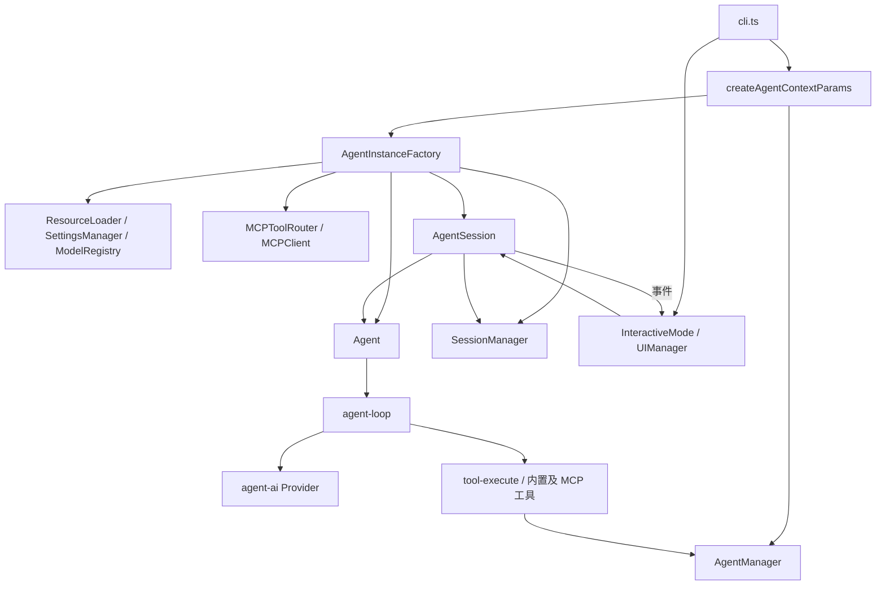

# Agent Orange 架构

Agent Orange 是运行在终端中的交互式 Agent。CLI 创建主代理运行时，TUI 接收输入并展示流式事件；Agent 核心负责模型调用、工具执行、会话和子代理。安装与配置示例见 [README](../README.md)。

## 组件关系

| 层 | 主要职责 | 关键文件 |
| --- | --- | --- |
| 入口和界面 | 解析工作目录、初始化 TUI、接收输入、渲染事件、处理斜杠命令 | `src/cli.ts`、`src/client-tui/interact.ts`、`src/client-tui/ui-manager.ts` |
| 运行时装配 | 加载角色与资源，创建主代理、子代理及其运行时 | `src/agent-core/agent-runtime/` |
| 会话协调 | 提交消息、维护排队输入、自动重试、上下文压缩、转发事件 | `src/agent-core/session.ts` |
| 推理循环 | 维护消息状态，调用模型，执行工具，处理下一轮及取消 | `src/agent-core/agent.ts`、`src/agent-core/agent-loop.ts`、`src/agent-core/tool-execute.ts` |
| 模型适配 | 按 API 类型选择 Provider，统一流式响应和消息类型 | `src/agent-ai/` |
| 持久化 | 以追加方式保存会话记录，重建当前分支上下文 | `src/agent-core/session-manager.ts`、`src/agent-core/session-manager-helper.ts` |

## 按需深入

从上面的组件关系入手，再按要解决的问题阅读：

| 想了解 | 阅读 |
| --- | --- |
| 启动时如何装配角色、模型、工具和配置 | [启动与配置装配](architecture/runtime-setup.md) |
| 输入如何经过会话、模型和工具并回到界面 | [一次输入的执行链](architecture/request-flow.md) |
| 会话如何持久化、压缩，以及如何执行子代理 | [会话和子代理](architecture/sessions-and-delegation.md) |
| 如何扩展工具、模型 API、角色或 TUI 命令 | [扩展位置与实现边界](architecture/extension-points.md) |
| 需要按路径查找具体源文件的职责 | [项目文件索引](architecture/code-map.md) |
| 需要浏览完整目录结构 | [项目目录树](architecture/repository-tree.md) |
