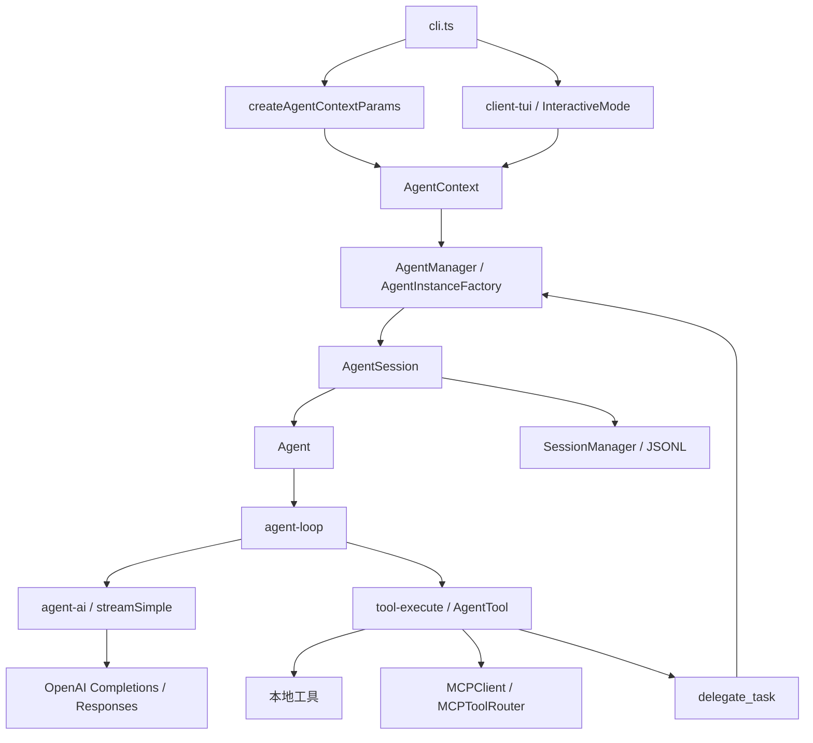

# 架构总览

[返回文档目录](README.md)

Agent Orange 将终端交互、Agent 执行与模型协议适配拆成三个主要层次。应用入口是 `src/cli.ts`，发布命令为 `orange`，构建产物位于 `dist/`。

## 模块边界

| 层或模块                   | 职责                                                         |
| -------------------------- | ------------------------------------------------------------ |
| `client-tui`               | 输入、快捷键、命令、选择器、主题和流式消息渲染               |
| `agent-core/agent-runtime` | 装配共享服务、创建代理实例、管理活动代理与会话切换           |
| `AgentSession`             | 包装一次会话的交互策略：消息记录、队列、模型切换、重试和压缩 |
| `Agent` 与 `agent-loop`    | 保存运行状态，驱动模型与工具交替执行，发布运行事件           |
| `SessionManager`           | 管理会话条目、分支路径、JSONL 存储和上下文重建               |
| `agent-ai`                 | 统一模型、消息和事件类型，按 API 协议路由流式请求            |
| `config` 与 `utils`        | 全局路径、默认值、终端与文件处理等基础能力                   |

## 核心概念

- **角色配置**：`agents/*.toml` 定义指令及允许启用的工具、技能和 MCP。
- **AgentDefinition**：工厂装配后的角色定义，包含系统提示词和资源集合。
- **AgentInstance**：运行中的实例，由 ID、定义和运行时组成。
- **AgentRuntime**：包含 `Agent`、`AgentSession` 与 `SessionManager`。
- **AgentContext**：为 TUI 提供活动实例及共享服务的访问入口。
- **provider 与 api**：provider 是模型配置中的服务名称；api 是实际适配协议，例如 `openai-responses`。

## 数据与事件

模型层使用统一的 `Message` 与 `AssistantMessageEvent`；核心层使用 `AgentMessage` 与 `AgentEvent`；会话层补充队列、重试、压缩等事件。TUI 订阅会话及子代理事件更新画面，消息持久化由会话层处理。

会话历史和发给模型的上下文并不相同：历史保留消息与压缩记录，上下文重建时使用摘要和保留的近期消息。项目规则与技能元信息在构建系统提示词时注入。

更多细节见[启动与资源装配](architecture/runtime-setup.md)、[请求与事件流](architecture/request-flow.md)和[会话专题](architecture/sessions-and-delegation.md)。
