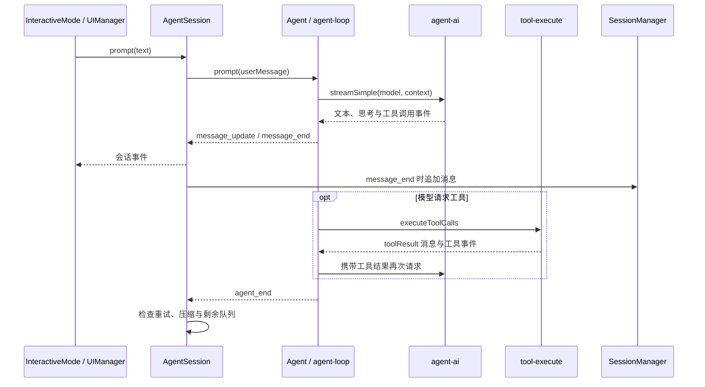

# 请求与事件流

[返回文档目录](../README.md)

## 从输入到模型

`InteractiveMode.run` 获取用户输入后调用 `AgentSession.prompt`。会话验证模型，将文本与可选图片转换为用户消息。运行中调用必须指定 `streamingBehavior`：`steer` 用于下一轮插话，`followUp` 用于当前任务结束后继续。

`Agent` 管理运行状态和取消信号。`agent-loop` 在请求前执行可选上下文转换，再通过 `convertToLlm` 生成模型消息。`streamSimple` 根据 `model.api` 查询已注册的协议适配器。

模型返回的部分消息保留在上下文中，增量事件更新这条消息，完成后替换为最终消息。循环把文本、思考和工具调用的增量统一映射为核心层 `message_update`。

## 工具执行

`tool-execute.ts` 查找工具、验证参数并调用执行函数，提供调用前后钩子和增量更新回调。失败会转为带 `isError` 的工具结果。

默认并行执行一批工具；当配置指定串行，或批次中有工具声明 `executionMode: "sequential"` 时，整批串行执行。并行完成后的结果消息仍按原工具调用顺序加入上下文。只有本批所有已完成工具均返回 `terminate: true`，批次才请求终止后续工具循环。

工具结果加入上下文后，模型可以继续调用工具或给出回答。每轮后支持准备下一轮上下文和停止判断等钩子；内层循环处理工具与插话，外层循环处理后续消息。

## 事件与界面

核心事件包括 `agent_start`、`turn_start`、`message_start`、`message_update`、`message_end`、`tool_execution_start/update/end`、`turn_end` 和 `agent_end`。

`AgentSession` 在 `message_end` 保存用户、助手和工具结果消息，并转发事件；会话还发布重试、压缩和队列变化事件。`UIManager` 负责订阅和渲染，新建或恢复会话后重新绑定当前会话。
