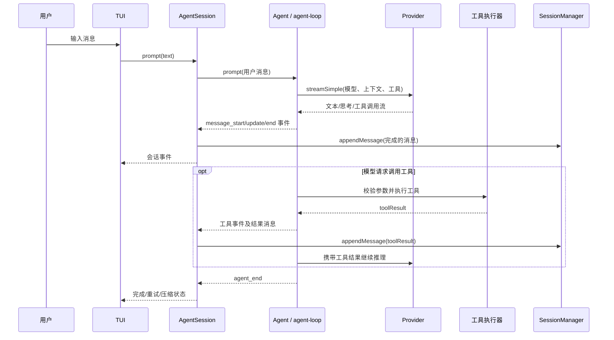

# 一次输入的执行链

[返回架构概览](../architecture.md)

`Agent` 持有当前消息、模型、工具、思考等级和运行状态，并提供订阅、取消、继续执行以及消息排队接口。`agent-loop.ts` 将上下文转换为统一的模型消息，使用 `agent-ai/stream.ts` 按模型的 `api` 字段找到 Provider。Provider 将响应转成统一的 `AssistantMessageEvent` 流。当前内置注册的 API 类型是 `openai-completions` 与 `openai-responses`。

模型返回工具调用时，`tool-execute.ts` 先匹配工具、校验参数，再执行并生成 `toolResult` 消息。默认可并发执行一批工具；全局执行模式或任一工具标记为顺序执行时，整批按顺序处理。工具结果进入下一轮模型上下文，直到没有工具调用或循环结束。运行中提交的新消息可作为下一轮插入的 steering 消息，或作为本次运行结束后的 follow-up 消息。

`AgentSession` 订阅 Agent 事件：完成的用户消息、助手消息和工具结果在 `message_end` 时交给 `SessionManager`；同一事件流也供 TUI 渲染。会话层还处理可重试错误、上下文溢出与自动/手动压缩。压缩由 `harness/compaction.ts` 生成摘要，写入独立的 compaction 记录，再以重建后的上下文更新 Agent 消息。

继续阅读：[会话和子代理](sessions-and-delegation.md)。
